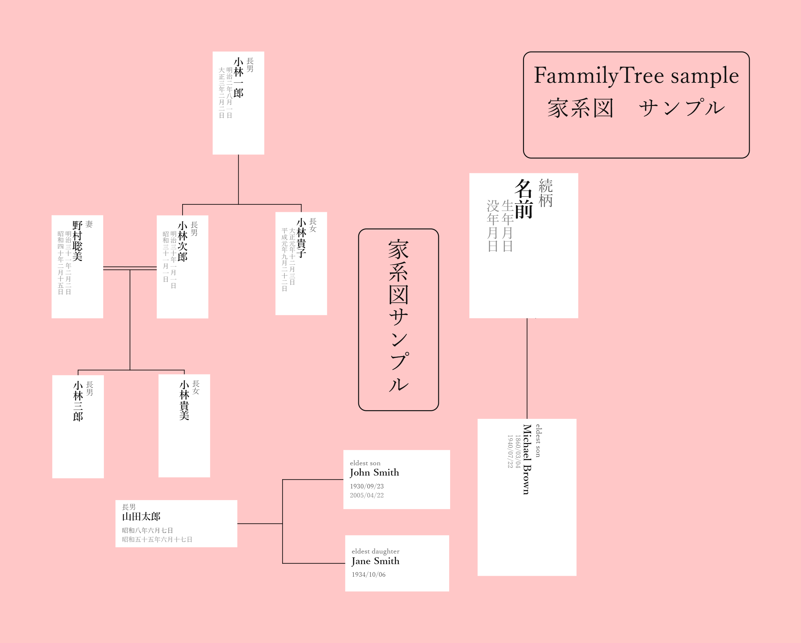

# FamilyTree

**家系図作成ソフト** — Electron製のデスクトップアプリです。  
縦書き・横書きの家系図ノードで、日本語にも英語にも対応した家系図を直感的に作れます。

---

## 特徴

- **縦書き・横書きの家系図ノード**  
  縦型は名前が縦書き、生年月日・没年月日も縦書きで表示。続柄は名前の右に並びます。  
  横型はコンパクトな横レイアウトで、複数のノードを横に並べた家系図に最適です。

- **フォーク接続（1対多）**  
  1つの親ノードから複数の子ノードへのT字接続線。右クリック→「フォーク接続」で選択・確定するだけ。

- **夫婦線（二重線）**  
  接続線を右クリック→「二重線（夫婦線）に切替」で二重線になります。  
  もう一度右クリックで「一本線に戻す」。

- **中点からのフォーク接続**  
  夫婦線を右クリック→「この線の中点からフォーク接続」で、夫婦の中心から子への接続線が引けます。

- **テキストノード**  
  縦書き・横書きの自由なテキスト枠。枠あり・なし切替可能。

- **背景色の変更**  
  ツールバーの背景カラーピッカーでキャンバスの背景色を自由に変更できます。  
  PNG・SVG出力時にも反映されます。

- **整列補助線（スナップ線）**  
  ノードをドラッグ中、他のノードの上端・中央・下端・左端・右端に近づくと青い補助線が自動表示されます。揃えたらドロップするだけ。

- **PNG / SVG 出力**  
  ツールバーから高品質な画像を出力できます。

- **多言語対応**  
  日本語・英語・中国語（簡体・繁体）・韓国語・スペイン語に対応。

- **自動バージョンアップ通知**  
  起動時に最新バージョンを確認し、更新がある場合は案内します。

---

## 操作方法

### ノードの追加
キャンバスを**右クリック** → 「ノードを追加」

### ノードの編集
ノードをクリックして選択 → 右パネルで名前・続柄・生年月日・没年月日・フォント・色を編集

### 接続線を引く
1. ノードを**右クリック** → 「ここから接続」
2. 接続先のノードをクリック

### フォーク接続（1対多）
1. 親ノードを**右クリック** → 「フォーク接続（1対多）」
2. 子ノードを順にクリックして選択
3. 「確定」ボタンで完了
4. フォーク線を右クリック → 削除

### 夫婦線（二重線）から子供へ接続
1. 夫婦を横並びに配置して接続線を引く
2. 接続線を右クリック → 「二重線（夫婦線）に切替」
3. 同じ線を右クリック → 「この線の中点からフォーク接続」
4. 子ノードを選択して確定

### ファイルの保存・読み込み
- 保存：`Ctrl+S`（`.ft`形式）
- 開く：`Ctrl+O`
- PNG出力：ツールバー「画像出力 (PNG)」
- SVG出力：ツールバー「画像出力 (SVG)」

---

## 作者

**daigorou-addon**
- GitHub: [daigorou-Tools](https://daigorou-addon.github.io/daigorou-tools/)
- Support: [buymeacoffee.com/daigorou](https://buymeacoffee.com/daigorou)

------------------------------------------------------------

# FamilyTree

**Family tree creation software** — An Electron desktop application.
Create family trees intuitively using vertical and horizontal family tree nodes with support for both Japanese and English.

---

## Features

- **Vertical and horizontal family tree nodes**  
  Vertical nodes display names, birth dates, and death dates vertically, while relationships are shown beside the name. Horizontal nodes provide a compact layout suitable for wide family trees.

- **Fork connections (one-to-many)**  
  Connect one parent node to multiple child nodes with a T-shaped branch.

- **Double-line spouse connections**  
  Convert a normal connection into a double-line spouse connection and switch it back at any time.

- **Fork connections from the midpoint**  
  Create child branches directly from the midpoint of a spouse connection.

- **Text nodes**  
  Freely place vertical or horizontal text boxes with or without borders.

- **Background color**  
  Change the canvas background color. The selected color is also reflected when exporting PNG or SVG images.

- **Alignment guides (snap lines)**  
  Blue alignment guides automatically appear while dragging nodes to help align edges and centers.

- **PNG / SVG export**  
  Export high-quality images directly from the toolbar.

- **Multilingual support**  
  Supports Japanese, English, Simplified Chinese, Traditional Chinese, Korean, and Spanish.

- **Automatic update notification**  
  Checks for new versions when the application starts.

---

## How to Use

### Add a node
Right-click the canvas and choose **Add Node**.

### Edit a node
Select a node and edit its name, relationship, birth date, death date, font, and colors in the right panel.

### Create a connection
1. Right-click a node and choose **Connect from here**.
2. Click the destination node.

### Fork connection (one-to-many)
1. Right-click the parent node.
2. Choose **Fork Connection (One-to-Many)**.
3. Select child nodes.
4. Click **Confirm**.

### Connect children from a spouse line
1. Create a spouse connection.
2. Convert it to a double line.
3. Right-click the line and create a fork connection from its midpoint.
4. Select the child nodes.

---

## Author

**daigorou-addon**
- GitHub: https://github.com/daigorou-addon
- Support: https://buymeacoffee.com/daigorou
